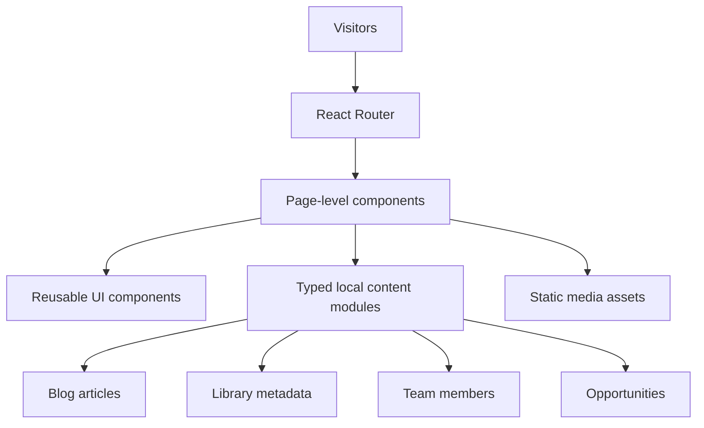
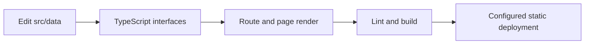

<p align="center"></p>

<h1 align="center">Digital Comps</h1>
<p align="center"><strong>A digital literacy and community-content website</strong></p>
<p align="center">
  
  
  
  
</p>
<p align="center">
  <a href="https://digital-citizen-taupe.vercel.app">Website</a> ·
  <a href="#site-features">Features</a> ·
  <a href="#content-architecture">Architecture</a> ·
  <a href="#local-development">Get started</a> ·
  <a href="docs/data_layer_structure.md">Data layer</a>
</p>

Digital Comps is a React/TypeScript website for digital-skill content, team profiles, learning resources and opportunities. The current codebase uses client-side routing and local TypeScript content modules; the presence of an installed dependency does not establish a live CMS or backend integration.

## Site features

| | Section | Source route |
| :--: | --- | --- |
|  | **Articles** | `/blog` and `/blog/:id` |
|  | **Media library** | `/library`, video and album details |
|  | **Team & opportunities** | `/team`, `/team/:id`, `/opportunities` |

Additional routes include `/privacy`, `/terms` and `/contact`. Routes listed above come from `src/App.tsx` and do not certify publication completeness.

## Content architecture





This is a code-derived content flow, not evidence of a database, API data sync or deployment health.

## Technology stack

| Area | Implementation |
| --- | --- |
| Web | React 19, React Router, TypeScript, Vite 8 |
| UI | Tailwind CSS, Lucide React, Framer Motion |
| Local content | `src/data/` and types under `src/types/` |
| Internationalization | i18next/react-i18next dependencies |
| Static hosting | Vercel configuration in `vercel.json` |

## Local development

Requirements: Node.js compatible with the committed dependencies and npm.

```bash
npm ci
npm run dev
```

```bash
npm run lint
npm run build
npm run preview
```

The commands are available project scripts, not a report of automated CI passing.

## Repository layout

```text
src/
  assets/         Images, branding and team portraits
  components/     Reusable UI components
  data/           Typed static content
  pages/          React Router pages
  types/          TypeScript data contracts
public/           Public static assets
docs/             Design and implementation documentation
```

## Documentation and publication safeguards

- [Typed content architecture](docs/data_layer_structure.md)
- [Implementation plan](docs/implementation_plan.md)
- [Multilingual content plan](docs/implementation_plan_for_multiple-language.md)
- [UI/UX review](docs/ui_ux_improvements_report.md)

**Media rights and personal information:** This public repository contains team portrait images and substantial graphical assets. Confirm contributor consent and publication/redistribution rights, and avoid committing private contact details or unlicensed media. Large PNG sources may also merit an image optimization pass. A public GitHub repository does not automatically grant redistribution rights without a declared license.
